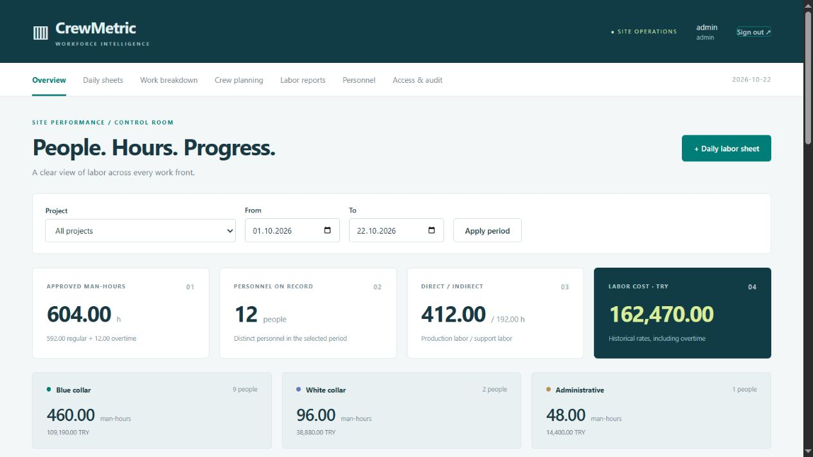

# CrewMetric

Construction workforce management with daily labor sheets, crew planning, measured production and man-hour performance. Follow a plastering crew, reinforcement subcontractor, site engineer and office team in the same workspace while keeping their work and personnel categories distinct.



## Capabilities

- Multiple projects, blocks, floors and work packages.
- Blue-collar, white-collar and administrative personnel classifications.
- Plastering, painting, electrical, plumbing, floor finishes, reinforcement, formwork, concrete, masonry, HVAC, engineering, safety, administration and logistics specialties.
- Crews and contractors, active/inactive personnel and individual hourly cost rates.
- Daily regular/overtime attendance in decimal hours or `H:MM`.
- Individual attendance rows or pasted CSV for up to 100 people per daily sheet.
- One measured output per activity/day, independent of the number of people on the sheet.
- Draft, submission, independent approval, return for correction and recorded voiding.
- Cross-project checks against more than 24 approved hours per person/day.
- Daily capacity planning across projects, including unallocated and approved actual hours.
- Budget hours, earned hours, hours per production unit, labor efficiency and completion-hour forecasts.
- Period, project, trade and personnel-category reports; safe CSV attendance export.
- Administrator-only financial figures, historical rate snapshots and an action audit trail.
- Online database backup, integrity verification and automated checks on Windows/Linux.

## Quick start

Requires Python 3.11 or newer.

```powershell
python -m venv .venv
.venv\Scripts\python -m pip install -r requirements.txt
.venv\Scripts\python -m pip install --no-deps -e .
.venv\Scripts\python -m crewmetric demo
.venv\Scripts\python -m crewmetric serve
```

Open http://127.0.0.1:8772. The demo has `admin` and `reviewer` administrator accounts and a `foreman` supervisor account. They share a newly generated demonstration password stored in `runtime/crewmetric-credential.txt`. All names, cost rates, projects and attendance are fictional. Six approved example days contain 588 man-hours for twelve people, plus draft/submitted sheets for the current day.

For an empty site workspace:

```powershell
python -m crewmetric init --database runtime/live.sqlite --username site-admin --currency TRY
python -m crewmetric serve --database runtime/live.sqlite
```

The initializer prompts for a password. Add another administrator through Access & audit so independently authored sheets can be approved. On Linux/macOS use `.venv/bin/python` instead of `.venv\Scripts\python`.

## Daily workflow

1. Register projects, crews and personnel. Assign a category, specialty, hourly labor cost, overtime multiplier and daily planning capacity.
2. Define each work package with a zone, trade, target quantity and labor-hour budget. Use indirect packages for engineering, safety, administration or support activities that have no measured production output.
3. Record a daily sheet for a package. Add each person once, regular hours, overtime and the team’s measured output. The browser provides sixteen individual rows; CSV handles up to one hundred.
4. Submit the draft. A different administrator approves it after checking attendance and production. A returned draft allows quantity, notes and existing attendance hours to be corrected. Original rate snapshots are retained.
5. Use approved records in reports. Void an incorrect approved sheet with a reason, then create a corrected replacement; original data and history remain available.

Only one approved sheet is allowed for a work package/date. Consolidate all crews on that work front into it so output is not counted twice. A person can work on several packages or projects on the same day, with a combined ceiling of 24 clock hours. This ceiling is a data-consistency check, not a recommended working schedule.

### Bulk attendance

Paste this table in the daily sheet’s bulk section and leave individual rows empty:

```csv
personnel_code,regular_hours,overtime_hours
P-001,8,1
P-002,7:30,0
```

Codes must match active registered personnel. Duplicate people, missing columns, invalid durations or more than one hundred rows reject the entire draft. The completed quantity remains one separate field for the whole team.

## Calculation model

| Measure | Calculation |
| --- | --- |
| Man-hours | Sum of regular + overtime clock minutes ÷ 60 |
| Recorded labor cost | Regular hours × saved rate + overtime hours × saved rate × saved multiplier |
| Hours per unit | Approved man-hours ÷ approved production quantity for that package |
| Earned budget hours | Budget hours × completed quantity ÷ target quantity |
| Labor efficiency | Earned budget hours ÷ actual man-hours |
| Forecast completion hours | Actual hours × target quantity ÷ completed quantity |

Four workers each working eight hours produce **32 man-hours**. If they complete 160 m² of plaster, the measured rate is **0.20 h/m²**. With a budget of 150 hours for 1,000 m², earned hours are 24, efficiency is **0.75×**, and the linear forecast is **200 hours** at the observed rate.

Overtime multipliers affect cost, not clock hours. Monetary values use integer currency cents; durations use integer minutes; production quantities use integer thousandths. Costs round half-up once per attendance line. Personnel category, trade, crew, contractor, hourly rate and overtime factor are captured when a draft is created. Names and personnel codes are current register labels.

Forecasts assume the observed production rate continues; they do not model weather, learning curves or future changes in crew composition. No forecast is shown before positive output exists. Indirect work is reported in hours without production efficiency. Different production units and work packages are never combined into a single output total. Output can exceed target to reflect measured scope growth; budgets are baselines rather than automatic caps.

## Reports and access

| Capability | Administrator | Supervisor | Viewer |
| --- | --- | --- | --- |
| Read hours, production and sheets | Yes | Yes | Yes |
| Export approved attendance | Yes | Yes | Yes |
| Create work packages and labor sheets | Yes | Yes | No |
| Plan daily personnel allocation | Yes | Yes | No |
| Register projects, crews and personnel | Yes | No | No |
| Review another author’s submitted sheet | Yes | No | No |
| See cost rates and financial totals | Yes | No | No |
| Void approved sheets / provision accounts | Yes | No | No |

Dashboard headline figures and trade/category summaries use the selected reporting period. The work-front performance table explicitly uses all-time approved progress for the selected project. CSV follows the selected period/project and omits all financial columns for non-administrators. Drafts, submitted and void sheets never contribute to reported actuals.

Planning allocations are separate from attendance. Allocations cannot exceed each person’s configured daily capacity across projects; actual work can include overtime. Planning does not imply presence, and missing attendance is not automatically classified as leave or absence.

## Backup and checks

```powershell
python -m crewmetric backup --database runtime/live.sqlite --output backups/site-2026-10-22.sqlite
python -m crewmetric check --database backups/site-2026-10-22.sqlite
python -m unittest discover -s tests -v
```

Create the backup directory first. Backups use SQLite’s online backup API, including committed WAL records, and refuse to overwrite an existing file. Keep backups and runtime credentials outside the repository. To restore, stop the server and start it using the verified backup at a new database path. Retain or separately restore the session key if existing sessions must remain usable.

The test suite covers calculation precision, concurrent approvals, cross-project hour limits, rate snapshots, production double-counting, draft corrections, bulk attendance, permissions, financial masking, CSRF, CSV injection, demo creation and backup restoration.

## Deployment boundaries

The default Waitress listener is local-only. For HTTPS behind a reverse proxy, set a stable `CREWMETRIC_SECRET_KEY` of at least 32 characters and pass `--secure-cookies`. A generated `.crewmetric-key` beside the database is used when the environment key is absent. Never publish or serve the runtime directory.

This is a single-organization application using local SQLite storage. All authenticated users can read operational personnel and attendance records; financial figures are limited to administrators. It has no tenant isolation, SSO, account-recovery interface or automated payroll/tax calculation. Hourly rates and overtime factors are configurable planning inputs. Work dates are entered explicitly; audit timestamps use UTC. Restrict access and protect the database and backups as personnel records.

The in-process login limiter resets at restart. An externally accessible installation needs HTTPS, proxy-level rate limits and appropriate network access controls. SQLite should remain on reliable local storage. See [architecture](docs/architecture.md) and [operations](docs/operations.md) for the data lifecycle and calculations.
